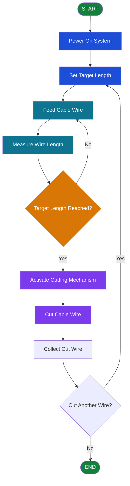

# Automated-Measurement-and-Cutting-Cable-Wires
PD 1 Prototype Project

# ⚙️ Automated Measurement and Cutting Cable Wires Prototype

  
  

  <strong>Precision • Efficiency • Automation</strong>

## 📌 Project Description

The **Automated Measurement and Cutting Cable Wires Prototype** is an engineering project designed to automate the measurement and cutting of cable wires to a desired length. The prototype aims to reduce manual work, improve measurement consistency, and make the cable preparation process more efficient.

By combining a measuring mechanism, a wire-feeding system, a controller, and a cutting mechanism, the system is intended to measure cable wires and cut them according to the selected length.

## 🎯 Objectives

- Automate the measurement of cable wire lengths.
- Cut wires according to a desired measurement.
- Reduce repetitive manual measuring and cutting.
- Improve consistency and efficiency in wire preparation.
- Demonstrate the application of automation in engineering.

## ✨ Main Functions

- 📏 **Length Selection** — Set the desired wire length, if supported by the prototype.
- ⚙️ **Wire Feeding** — Move the cable through the measuring mechanism.
- 📐 **Length Measurement** — Measure the wire using the prototype's measuring system.
- ✂️ **Automatic Cutting** — Cut the wire when the target length is reached.
- 🔁 **Repeatable Operation** — Repeat the process for additional cable pieces, if implemented.

*Keep only the functions supported by your actual prototype.*

## 🔄 System Workflow

1. **Start the System** — Turn on the prototype.
2. **Set the Desired Length** — Enter or select the required cable length, if the system supports this.
3. **Feed the Cable** — Guide the cable into the feeding mechanism.
4. **Measure the Cable** — The measuring mechanism tracks the cable length.
5. **Check the Target Length** — The controller checks whether the desired length has been reached.
6. **Activate the Cutter** — The cutting mechanism cuts the cable at the target length.
7. **Finish or Repeat** — Collect the cut cable and repeat as needed.

## 📊 System Flowchart

## 🧰 Materials and Components

The following is a **suggested checklist** for documenting the prototype. Mark or remove components that you did not use.

| Material / Component | Purpose |
|---|---|
| Microcontroller (Arduino or another controller) | Controls the measurement and cutting process, if used |
| Measuring sensor or rotary encoder | Tracks cable length |
| Motor or DC gear motor | Feeds the cable through the system |
| Cutting mechanism | Cuts the cable at the target length |
| Motor driver or relay module | Controls motors or actuators, if required |
| Power supply | Provides electrical power |
| Push buttons or switches | Starts, stops, or controls the system |
| LCD or display module | Shows the selected length or measurement, if used |
| Frame or base | Supports the prototype components |
| Rollers or guide wheels | Guides and feeds the cable |
| Connecting wires and terminals | Connects electrical components |
| Screws, nuts, and fasteners | Secures the mechanical assembly |

**Important:** This table is a reference list, not a confirmed inventory of your actual prototype. Update it to match the materials you used.

## 💻 Programming Languages and Technologies

Add the logos that correspond to your actual controller and software.

### Example: If You Used Arduino

  
  

  <strong>Arduino IDE</strong> &nbsp; | &nbsp; <strong>Arduino C/C++</strong>

- **Arduino C/C++** — Can be used to program the controller, read sensors, control motors, and activate the cutting mechanism.
- **Arduino IDE** — Can be used to write, compile, and upload the program to an Arduino board.

*These are examples only. Use them if your prototype was actually programmed with Arduino.*

### Other Possible Technologies

- **ESP32 / ESP8266** — If an ESP-based controller was used.
- **Python** — If a computer or compatible controller ran the application logic.
- **PLC Ladder Logic** — If the system used a programmable logic controller.

## 🏗️ How the System Works

The prototype combines mechanical and electrical components to perform a repeated measurement-and-cutting task. The measuring mechanism determines how much cable has passed through the system. Once the selected length is reached, the controller can activate the cutting mechanism, provided the prototype includes the necessary sensors and control circuitry.

The actual accuracy and operating speed depend on the mechanical design, measurement method, controller, and cutting mechanism.

## 🚀 Potential Improvements

- Add a digital display for length selection and measurement.
- Improve measurement calibration and cutting accuracy.
- Include an emergency stop and protective enclosure.
- Add a counter for the number of wires cut.
- Improve cable guidance to reduce slipping and measurement errors.
- Add fault detection and clear status indicators.

## 👨‍💻 Project Information

- **Project Title:** Automated Measurement and Cutting Cable Wires Prototype
- **Project Type:** Engineering / Automation Prototype
- **Developer:** [Your Name]
- **Development Year:** [Your Project Year]
- **Programming Language:** [Enter Actual Language]
- **Controller:** [Enter Actual Controller]

---

  <strong>Engineering Automation in Action ⚙️</strong> 
  <em>Designed to improve efficiency and measurement consistency.</em>

